# Current Offline Perception Architecture

This diagram shows the implemented, ROS-independent replay pipeline. All boxes and
arrows are solid because every depicted component and data flow exists in the
current repository. The GPU experiments use recorded RGB-D data, not a live camera.

```mermaid
flowchart LR
    classDef implemented fill:#EAF2F8,stroke:#155A8A,stroke-width:2px,color:#17202A
    classDef contract fill:#F4F6F7,stroke:#566573,stroke-width:2px,color:#17202A
    classDef output fill:#E9F7EF,stroke:#2E7D5B,stroke-width:2px,color:#17202A
    classDef config fill:#FEF9E7,stroke:#B7950B,stroke-width:2px,color:#17202A

    subgraph INPUT[Recorded Input and Configuration]
        direction TB
        DATA["Recorded RGB-D dataset<br/>rgb/*.png · depth/*.png · camera.json"]
        YAML["YAML configuration<br/>configs/perception*.yaml"]
    end

    subgraph REPLAY[Offline Replay]
        direction LR
        CLI["scripts/replay_perception.py"]
        SOURCE["RecordedSequenceSource<br/>sources.py"]
        PRE["RGB/depth preprocessing<br/>rgbd.py"]
        FRAME["RGBDFrame<br/>interfaces.py"]
    end

    subgraph PIPELINE[PerceptionPipeline · tracker.py]
        direction TB
        STATE["TrackerState<br/>UNINITIALIZED · TRACKING · LOST"]
        YOLO["YoloSegmenter<br/>segmenter.py<br/>mask + candidate selection"]
        SEG["Segmentation<br/>mask · confidence · metadata"]
        FP["FoundationPoseEstimator<br/>foundationpose.py<br/>register() / track()"]
        VALID["Pose validation<br/>SE(3) · depth · translation jump<br/>mask centroid / projected depth"]
        RECOVERY["Detection-guided recovery<br/>re-detect + re-register"]
    end

    subgraph RESULT[Validated Results]
        direction TB
        POSE["ObjectPoseEstimate<br/>T_frame_object in camera frame<br/>valid · status · failure reason"]
        FILES["Run artifacts<br/>poses.npy · poses.csv · metrics.json<br/>config.yaml · optional manifest/video"]
        DIAG["Per-frame diagnostics<br/>state · LOST streak · depth checks<br/>recovery events · inference time"]
    end

    subgraph EVAL[Evaluation and Regression]
        direction TB
        PREFLIGHT["run_gpu_preflight()<br/>regression.py"]
        GPU["Opt-in GPU integration test<br/>tests/test_gpu_integration.py"]
        COMPARE["Legacy/modular comparison<br/>compare_perception_runs.py"]
    end

    DATA --> SOURCE
    YAML --> CLI
    CLI --> SOURCE
    SOURCE --> PRE
    PRE --> FRAME
    FRAME --> STATE

    STATE -->|UNINITIALIZED or LOST| YOLO
    YOLO --> SEG
    SEG -->|object mask| FP
    STATE -->|TRACKING| FP
    FP -->|candidate 6D pose| VALID
    VALID -->|accepted| STATE
    STATE -->|TRACKED / REGISTERED / REREGISTERED| POSE
    VALID -->|tracking failure| RECOVERY
    RECOVERY --> YOLO

    POSE --> FILES
    STATE --> DIAG
    DIAG --> FILES
    YAML --> PREFLIGHT
    DATA --> PREFLIGHT
    PREFLIGHT --> GPU
    GPU -->|invokes public replay CLI| CLI
    FILES --> COMPARE

    class DATA,CLI,SOURCE,PRE,STATE,YOLO,FP,VALID,RECOVERY,PREFLIGHT,GPU,COMPARE implemented
    class FRAME,SEG contract
    class POSE,FILES,DIAG output
    class YAML config
```

## Legend

- **Solid border:** implemented component.
- **Solid arrow:** implemented data or control flow.
- Green boxes are outputs; gray boxes are typed runtime contracts; yellow is
  configuration.

The recovery edge is intentionally a feedback loop. A suspicious tracking result
is not emitted as valid: the pipeline re-runs detection and registration on the
same frame when recovery is enabled, or enters `LOST` and emits an invalid result.
