# Planned ROS1 Distributed Deployment

This diagram separates the planned laboratory, network, and Alibaba Cloud GPU
boundaries. Solid perception boxes reuse implemented modules. Dashed boxes and
arrows are proposals and are not present in the repository today.

```mermaid
flowchart LR
    classDef implemented fill:#EAF2F8,stroke:#155A8A,stroke-width:2px,color:#17202A
    classDef planned fill:#FFFFFF,stroke:#7F8C8D,stroke-width:2px,stroke-dasharray:7 5,color:#17202A
    classDef status fill:#E9F7EF,stroke:#2E7D5B,stroke-width:2px,color:#17202A

    subgraph LAB[Laboratory · ROS1 Noetic · Planned]
        direction TB
        CAMERA["RGB-D Camera"]
        DRIVER["ROS1 Camera Driver"]
        SYNC["RGB-D Synchronization"]
        BRIDGE["ROS1 Perception Bridge"]
        PUB["ROS1 Pose Publisher"]
        TF["TF / Camera-to-Robot Calibration"]
        POLICY["Future continual-learning policy"]
        ROBOT["Future KUKA Robot Integration<br/>motion planning / control"]

        CAMERA -.-> DRIVER
        DRIVER -.-> SYNC
        SYNC -.-> BRIDGE
        PUB -.-> TF
        TF -.-> POLICY
        POLICY -.-> ROBOT
    end

    subgraph NET[Secure Network Communication · Planned]
        direction TB
        REQUEST["RGB-D frames + camera metadata<br/>secure IPC/RPC protocol: TBD"]
        RESPONSE["Validated 6D pose + tracking status<br/>secure IPC/RPC protocol: TBD"]
    end

    subgraph CLOUD[Alibaba Cloud GPU · Planned Deployment Boundary]
        direction TB
        SERVICE["Remote Perception Service"]
        RGBD["RGBDFrame adapter"]
        YOLO["YoloSegmenter<br/>YOLO-Seg"]
        FP["FoundationPoseEstimator<br/>registration / tracking"]
        VALID["Pose validation"]
        STATE["PerceptionPipeline<br/>tracking state management"]
        RECOVERY["Detection-guided recovery"]
        RESULT["ObjectPoseEstimate<br/>camera-frame pose + validity/status"]

        SERVICE -.-> RGBD
        RGBD --> STATE
        STATE -->|UNINITIALIZED or LOST| YOLO
        YOLO -->|segmentation mask| FP
        STATE -->|TRACKING| FP
        FP --> VALID
        VALID -->|accepted| STATE
        VALID -->|tracking failure| RECOVERY
        RECOVERY --> YOLO
        STATE --> RESULT
    end

    BRIDGE -.-> REQUEST
    REQUEST -.-> SERVICE
    RESULT -.-> RESPONSE
    RESPONSE -.-> PUB

    class YOLO,FP,VALID,STATE,RECOVERY implemented
    class CAMERA,DRIVER,SYNC,BRIDGE,PUB,TF,POLICY,ROBOT,REQUEST,RESPONSE,SERVICE,RGBD planned
    class RESULT status

    style LAB fill:#FAFAFA,stroke:#7F8C8D,stroke-width:2px,stroke-dasharray:7 5
    style NET fill:#FAFAFA,stroke:#7F8C8D,stroke-width:2px,stroke-dasharray:7 5
    style CLOUD fill:#FAFAFA,stroke:#7F8C8D,stroke-width:2px,stroke-dasharray:7 5
```

## Legend

- **Solid border:** implemented perception module or existing output contract.
- **Dashed border:** planned integration or deployment component.
- **Solid arrow:** data/control flow already implemented inside the perception core.
- **Dashed arrow:** proposed live, ROS1, network, calibration, policy, or robot flow.

The transport is deliberately labeled **TBD**. No ZeroMQ, gRPC, ROS bridge, or
other IPC/RPC mechanism has been selected or implemented.
